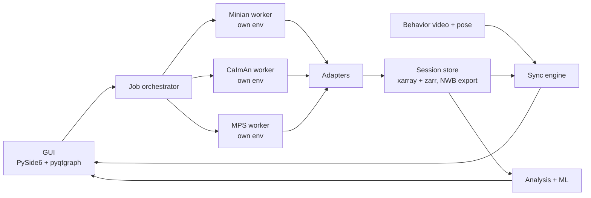

# Unified Calcium Imaging & Behavior Analysis Platform

*Project proposal — Sep 23, 2026 · @Grace. Working name TBD.*

## Summary

We propose an open-source Python desktop platform that takes a miniscope lab from raw video to behavior-linked results in one GUI. Users can run Minian, CaImAn (CNMF-E), or MPS for extraction, then scrub calcium traces and behavior video together on one time slider. Events they mark are immediately turned into peri-event analyses.

The contribution is not any single component; each exists somewhere. It is the missing combination for one-photon, freely moving experiments:

- **Choice of extraction backend:** users choose Minian, CaImAn or MPS for each session; the chosen backend runs in its own environment behind one interface, with outputs converted to one NWB-compatible data model.
- **Timestamp-correct synchronization:** calcium, behavior video and pose are aligned in seconds, handling dropped frames and differing frame rates.
- **Annotate-to-analyze loop:** every marked event updates peri-event heatmaps and per-cell responsiveness statistics.
- **Human-in-the-loop computer vision and ML:** an active-learning behavior classifier that works from pose or directly from video embeddings, a cell quality classifier, and transient-detection QC, all learning from the user's own marks.
- **LLM assistant layer:** parameter help, plain-English queries and auto-drafted methods sections. The LLM calls the platform's own functions and never computes results itself.

Primary users are behavioral neuroscience labs with little coding capacity, starting with the Moorman Lab's miniscope data at UMass Amherst.

---

## Background

The field has good extraction tools and good viewers, but they are separate products with separate data formats. The closest all-in-one tool, OptiNiSt, targets two-photon backends and treats behavior as a CSV rather than video.

| Tool | Language / UI | Extraction backends | Behavior video sync | Event-linked analysis | ML | Gap for miniscope labs |
|---|---|---|---|---|---|---|
| OptiNiSt (2025) | Python, browser GUI, Snakemake | Suite2p, CaImAn, LCCD, each in an isolated env | No; behavior as CSV input | Event-triggered averaging, correlation, CEBRA | CEBRA, decoding | No Minian or MPS; no video scrubbing or manual event marking |
| MPS (2025) | Python, no-code GUI | Own CNMF variant, long recordings | No | No | Supports lab-specific ROI models | Stops at extraction |
| CalTrig (2025) | Python, PyQt5 | None; reads Minian output | Yes | Transient identification | GRU/LSTM/Transformer transient detection | Minian-only; post-extraction only |
| CIAtah | MATLAB GUI | PCA-ICA, CNMF, CNMF-E, EXTRACT, CELLMax | Position tracking only | Some | Cell sorting | Requires MATLAB |
| Minian (2022) | Python, Jupyter | CNMF-E variant | No | No | No | Notebook-driven |
| CaImAn / mesmerize / masknmf | Python, notebooks + fastplotlib | CNMF, CNMF-E | Possible via custom plots | No | No | Maintainers steer new projects to masknmf |
| SNUB (2024) | Python viewer | None | Yes | No; a plotting library by design | No | Viewer only |
| Bento | MATLAB | None | Yes, with annotation | Limited | No | MATLAB, older, limited pose support |

Two other signals matter. A 2026 cross-session tracking paper describes matching the same cells across days as still unsolved for one-photon recordings. And backends disagree substantially on the same data: in the MIN1PIPE paper, PCA/ICA, MIN1PIPE and CNMF-E found 79, 357 and 598 ROIs on one recording.

## Gap analysis

The most useful gap to close is the path from extraction to a behavior-linked answer for one-photon, freely moving data. Today that path needs three to five tools and custom scripts. The gaps, ranked by value to a typical miniscope lab and by feasibility for this project:

1. **No miniscope-first pipeline lets users choose Minian, CaImAn or MPS from one GUI.** OptiNiSt proved the design (isolated environments per backend, NWB output) but chose two-photon backends. Minian and MPS users have no equivalent.
2. **Behavior is a second-class input.** Only viewers (SNUB, Bento) and CalTrig show video beside traces. None handle Miniscope timestamp files, dropped frames and camera drift as a core feature. Most scripts silently assume frame indices line up.
3. **Marking an event does not produce an analysis.** Viewers let you look; OptiNiSt analyzes a CSV you prepared elsewhere. No tool turns a keypress on the video into an updated peri-event heatmap and responsiveness test.
4. **Users cannot tell which extraction to trust.** Backends return very different cell sets on the same video. A per-cell quality score, learned from the user's own accept/reject decisions, would give a concrete signal within whichever backend they chose.
5. **ML is not trained on the user's own labels.** Pretrained classifiers rarely fit a lab's specific assay. An active-learning loop over the user's own marked events is missing from calcium tools.
6. **Cross-session cell tracking is still unsolved for one-photon data.** High impact, but a research problem on its own; treated here as a stretch goal via existing tools.

Gaps 1–3 are the core product. Gaps 4–5 are the ML and novelty contribution. Gap 6 is out of scope except through integration.

---

## Specific aims

**Aim 1: One GUI with a choice of three extraction backends.** Users pick Minian, CaImAn CNMF-E or MPS for each session. Only the chosen backend runs, as an isolated worker process with parameter presets and progress reporting. Convert every output to one data model with NWB export.
*Success:* a user selects any one backend and processes a raw video from the GUI, with no terminal use.

**Aim 2: Timestamp-correct multimodal viewer.** Load calcium movie, footprints, traces, behavior video(s) and DeepLabCut/SLEAP pose on one time slider in seconds. Detect and report dropped frames and clock drift.
*Success:* sync error under one calcium frame on a dataset with injected drops.

**Aim 3: Annotate-to-analyze loop.** Mark point events and bouts by hotkey while scrubbing. Each change updates peri-event heatmaps, population averages and per-cell shuffle-test responsiveness.
*Success:* a lab member goes from marked events to an exportable figure in under 10 minutes.

**Aim 4: Human-in-the-loop computer vision and ML.**
- (a) Active-learning behavior classifier with two input modes: pose features, or embeddings from a pretrained video model so labs can skip pose-model training.
- (b) Cell quality classifier on a pretrained CNN backbone, fine-tuned on the user's accept/reject decisions, working on any backend's output.
- (c) Animal and object tracking with SAM 2 from a single click, producing position, speed and zone-entry events automatically.
- (d) Transient-detection QC using a CalTrig-style sequence model.

*Success:* classifier reaches the user's labeling agreement with a fraction of manual labels; video-embedding mode performs within a few F1 points of pose mode; quality score predicts expert accept/reject decisions.

**Aim 5: LLM assistant layer.**
- (a) Parameter assistant that reads summary images and statistics, suggests starting backend parameters, and explains failed runs in plain English.
- (b) Methods and session-report generator built from the app's recorded provenance: backend, version, parameters and analyses.
- (c) Later: natural-language queries ("cells responsive to freezing within 2 s") translated into calls to the analysis functions.

*Success:* new users reach a usable extraction in fewer attempts with the assistant than without; generated methods need only minor edits from a lab member.

---

## System architecture

The GUI never imports a backend directly. Each backend runs in its own conda environment as a worker process, which avoids the numpy, Dask and CUDA version conflicts between Minian, CaImAn and MPS. OptiNiSt uses the same isolation idea. The user picks one backend per session, and only that worker runs.



The orchestrator launches workers and streams their progress; adapters turn each backend's output into one session model; the sync engine maps every stream onto a shared clock.

| Component | Choice | Why |
|---|---|---|
| GUI | PySide6 + pyqtgraph | Fast trace scrolling, LGPL licensing, mature |
| Video decoding | PyAV or decord, with a frame cache | Random-access scrubbing without loading whole videos |
| Job orchestration | Subprocess per job, JSON-lines progress; Snakemake later for batch | Crash isolation; one backend failing does not kill the GUI |
| Data model | xarray + zarr, NWB export via pynwb | Lazy loading for multi-hour recordings; standard for sharing |
| Time base | Per-stream timestamp vectors in seconds | Slider sets a time, never a frame index |
| Events | Tidy table: type, t_start, t_end, source, confidence | Manual and model events share one format |
| Packaging | Installer that creates the per-backend envs | Matches MPS's no-Git, no-terminal install |

The analysis layer is plain functions with no GUI imports. Everything the GUI does can also be scripted and unit-tested.

## Technical stack

The recommended stack is a Qt desktop app in a lightweight Python 3.11 environment that never imports a backend, built on existing neuro data libraries rather than custom readers. Reusing roiextractors, NeuroConv, pynapple and movement removes most of the file-format and alignment code, which is where projects like this usually stall.

| Layer | Recommended | Alternatives considered | Why |
|---|---|---|---|
| GUI | PySide6 + pyqtgraph | napari; web (FastAPI + React, like OptiNiSt); fastplotlib | Local multi-GB files and low-latency scrubbing favor desktop Qt. A web UI adds a server and video streaming. napari is image-centric; fastplotlib is GPU-fast but its API is younger |
| Calcium movie view | pyqtgraph ImageView over lazy zarr | napari embedded as an optional viewer | Keeps one event loop and one slider |
| Video decoding | PyAV (FFmpeg) + LRU frame cache | OpenCV, decord | Accurate seeking by timestamp; decord is less actively maintained |
| Raw Miniscope + timestamps | roiextractors `MiniscopeImagingExtractor` | Custom reader | Already concatenates .avi files and reads hardware timestamps from `timeStamps.csv` |
| Backend output adapters | roiextractors `CaimanSegmentationExtractor`; own Minian and MPS adapters | All custom | CaImAn is covered; Minian and MPS adapters are a contribution that can go upstream |
| NWB export | NeuroConv + pynwb | Custom HDF5 | Community standard; reviewers expect it |
| Internal store | xarray + zarr | HDF5 only | Lazy, chunked reads for multi-hour sessions; Minian already uses this format |
| Time series and peri-event analysis | pynapple (Tsd, IntervalSet, peri-event functions) | Custom numpy | Timestamp-aware alignment and interval logic already tested |
| Pose loading | movement | Per-tool parsers | One loader for DeepLabCut, SLEAP and LightningPose outputs |
| Statistics | scipy, statsmodels, numpy shuffle tests | — | Standard, transparent |
| Backend orchestration | One micromamba or pixi env per backend; subprocess workers reporting JSON-lines progress | Docker; Snakemake | No admin rights needed on lab PCs; Snakemake can be added later for batch runs |
| Parameters and config | Pydantic models, YAML presets | Plain dicts | Validated parameters per backend; the same schemas serve as LLM tool definitions |
| Classical ML | scikit-learn, LightGBM | — | Fast to retrain inside an active-learning loop |
| Deep learning | PyTorch; Hugging Face transformers for video embeddings; SAM 2 as stretch | TensorFlow | Model availability; CalTrig-style models port easily |
| LLM layer | Provider-agnostic client with tool calling over the Pydantic schemas; optional local model (e.g. Ollama) | Hard-coding one vendor | Labs may need data to stay local |
| Packaging | conda constructor or pixi-based installer creating all envs | pip only | Minian already has install friction on some platforms |
| Quality | pytest, pytest-qt, GitHub Actions on Windows and Linux; MkDocs documentation | — | JOSS requires tests and documentation |

## Machine learning components

The ML centerpiece is an active-learning behavior classifier that learns from the events users already mark. Other components integrate existing methods rather than reinventing them.

| Component | Input | Method | Status in field | Priority |
|---|---|---|---|---|
| Active-learning behavior classifier | Pose keypoints + derived features, or pretrained video embeddings | Gradient-boosted trees or small temporal model; uncertainty sampling proposes the next clips to label | Exists for behavior alone (e.g. DeepEthogram for pixels); not inside calcium tools | Core, novel |
| Video embedding backbone | Short behavior clips | Frozen pretrained video model (VideoMAE or V-JEPA style), embeddings cached per frame window | Mature models; rarely used in neuro tools | Core |
| Animal and object tracking | Behavior video + one click | SAM 2 video segmentation; derive position, speed, zone entries | Mature | Core |
| Cell quality classifier | Summary images, footprints, traces from the chosen backend | Pretrained CNN backbone + trace features, fine-tuned as the user curates cells | Backend-specific classifiers exist; none learns from user curation across backends | Core, novel |
| Transient-detection QC | ΔF/F, C, S traces | Retrain or reuse CalTrig-style GRU/Transformer; user corrections feed back | Published in CalTrig | Integrate |
| LLM parameter assistant | Summary images, statistics, error logs | LLM with tool calls into preview functions; suggests and explains parameters | Not available in calcium tools | Core |
| LLM methods and report generator | Recorded provenance | LLM drafts text from structured run metadata | Not available in calcium tools | Core, low risk |
| Natural-language queries | User question | LLM translates to calls on the analysis API | New | Later |
| Unsupervised behavior syllables | Pose | keypoint-MoSeq | Mature | Optional plugin |
| Neural–behavior embedding and decoding | Traces + labels or pose | CEBRA; linear decoders as baseline | Mature; OptiNiSt includes CEBRA | Optional plugin |
| Cross-session cell tracking | Footprints across days | Wrap CellReg-style or newer matching methods | Open problem for one-photon | Stretch |

The active-learning loop works like this. The user labels 10–20 bouts of a behavior. The model scores every frame, the GUI surfaces the least certain segments first, and the user accepts or corrects them. Model-labeled events enter the same event table with a confidence value, so every analysis in Aim 3 works on them unchanged.

The division of labor is deliberate. Trained vision models do measurement: tracking, classification, cell scoring. LLMs only operate the interface and write documentation, calling tested functions so every number stays reproducible. Vision-language models labeling behavior or interpreting neural data directly are out of scope because they are hard to validate.

---

## Validation and evaluation plan

Each aim has a measurable test, using simulated data where ground truth is needed and Moorman Lab recordings for real-world use.

| Aim | Test | Data | Metric |
|---|---|---|---|
| 1. Multi-backend | Process test videos with each backend from the GUI, one at a time; compare with each backend's own scripts | Simulated one-photon videos + 3–5 lab sessions | Identical outputs to native runs; zero terminal steps |
| 2. Sync | Inject known frame drops and drift, then recover alignment | Lab sessions with synthetic corruption | Sync error in ms; drop detection rate |
| 3. Annotate-to-analyze | Timed task with lab members new to the tool | Real sessions | Minutes from marked events to figure; System Usability Scale |
| 4a. Behavior classifier | Learning curve vs. number of labels; pose mode vs. video-embedding mode | 2–3 assays with expert labels | Frame-level and bout-level F1 vs. labels used |
| 4b. Quality score | Correlate score with expert accept/reject of cells | Sessions curated by an expert | ROC AUC |
| 4c. Tracking | Compare SAM 2 positions with hand-marked positions | Sampled frames from lab videos | Mean position error in pixels |
| 4d. Transient QC | Compare with CalTrig reported results and user corrections | CalTrig-style labeled traces | Precision, recall |
| 5a. Parameter assistant | New users run extraction with vs. without the assistant | Lab sessions | Attempts and time to an accepted extraction |
| 5b. Methods generator | Lab members rate and edit generated methods | Real runs | Edits needed; factual errors against provenance (target zero) |

All benchmarks will be scripts in the repository so others can rerun them.

## Timeline and milestones

The plan assumes part-time work across the 2026–27 academic year, with a usable viewer by winter break and a paper draft by summer 2027. The viewer comes before backend orchestration because it is useful to the lab immediately.

| Months | Milestone | Deliverable |
|---|---|---|
| Oct 2026 | Setup + MPS check | Repo, CI, env tooling; confirm whether MPS can be launched programmatically |
| Oct–Nov 2026 | Data model + adapters | Load Minian, CaImAn and MPS outputs into one session via roiextractors and own adapters; NWB export |
| Nov–Dec 2026 | Sync engine + viewer (v0.1) | Slider over calcium movie, traces, behavior video, pose; dropped-frame report |
| Jan–Feb 2027 | Annotate-to-analyze (v0.2) | Hotkey events, peri-event heatmaps, responsiveness tests; first lab users |
| Feb–Mar 2027 | Backend orchestration (v0.3) | Choose and run Minian or CaImAn from the GUI in isolated envs (MPS run or import); installer |
| Mar–Apr 2027 | ML (v0.4) | Active-learning classifier in pose and video-embedding modes; cell quality classifier if labels are ready |
| Apr 2027 | LLM (v0.5) | Methods and session-report generator |
| Apr–May 2027 | Validation | Sync benchmark, learning curves, user study |
| Jun–Aug 2027 | Release (v1.0) + paper | Docs, tutorial dataset, JOSS submission and bioRxiv preprint; stretch items only if ahead |

## Risks and mitigations

The biggest risk is installation and maintenance of three backends, not the science.

| Risk | Impact | Mitigation |
|---|---|---|
| Backend dependency conflicts (numpy, Dask, CUDA) | Install failures, user drop-off | One conda env per backend; pinned lockfiles; installer tested on Windows first |
| Upstream changes (CaImAn moving toward masknmf; Minian maintenance) | Adapters break | Thin adapters with version checks; test against pinned releases; add masknmf adapter when stable |
| MPS license or interface limits embedding | Aim 1 loses one backend | Contact MPS authors early; fall back to importing MPS outputs |
| Scope creep | Nothing ships | Viewer and event loop first; ML only after v0.2 has real users; natural-language queries last |
| Long recordings exceed RAM in the viewer | Crashes on multi-hour sessions | Lazy zarr reads, downsampled overviews, frame cache |
| Vision models need a GPU many labs lack | Slow or unusable CV features | Cache embeddings once per video; CPU fallback with smaller models; pose mode as alternative |
| LLM gives wrong parameters or invents methods details | Bad extractions; inaccurate papers | LLM only calls tested functions; methods text generated from recorded provenance and shown for review; optional local model for data privacy |
| Overlap with OptiNiSt or CalTrig | Weak novelty claim | Position as miniscope-first; contact both teams; contribute adapters upstream where sensible |
| Few expert labels for ML validation | Weak Aim 4 results | Use Moorman Lab curated sessions and CalTrig's published data where licensed |

## Feasibility and publishability assessment

**Verdict:** the approach is sound and the core is publishable, but all five aims will not fit in one part-time year. Cut to Aims 1–3 plus one ML result and one LLM feature for year one, and treat the rest as stretch.

**Is this the best technical approach?** Mostly yes. Three choices matter most and are correct: isolated per-backend environments (proven by OptiNiSt), a seconds-based time base, and a scriptable analysis layer separate from the GUI. The main change from the first draft is to build on roiextractors, NeuroConv, pynapple and movement instead of writing readers and alignment code. A web UI would suit your FastAPI experience, but it makes local video scrubbing harder; stay with Qt.

**Is the gap publishable?** Yes as a software paper, with a narrower claim than "a new platform." Reviewers will compare against OptiNiSt, CalTrig and SNUB, so the claims must be specific:

| Claim | Defensible? | Evidence needed |
|---|---|---|
| First Python GUI letting miniscope labs choose Minian, CaImAn or MPS and continue into behavior analysis | Yes | Feature comparison table; install and run tests |
| Timestamp-correct sync with dropped-frame detection | Yes | Synthetic corruption benchmark |
| Annotate-to-analyze loop | Yes, the strongest usability claim | Timed user study with lab members |
| Active learning from video embeddings matches pose-based labeling | Yes, if the result holds | Learning curves on 2–3 assays |
| Cell quality classifier generalizes across backends | Possible | Expert-curated sessions from each backend |
| LLM parameter assistant helps | Weak unless measured | Small with/without study |

Best venues, in order: JOSS (software paper, needs tests, docs and real users), then eNeuro or Neuroinformatics methods if you add a biological demonstration on Moorman Lab data. A bioRxiv preprint alongside either is standard.

**Can it be finished in a year?** At an estimated 10–15 hours per week (roughly 400–600 hours), the core is realistic and the full plan is not.

| Component | Year one? | Reason |
|---|---|---|
| Aim 1: backend choice, isolated envs, installer | Yes | Core claim; start with Minian and CaImAn, add MPS once its programmatic entry point is confirmed |
| Aim 2: sync engine + viewer | Yes | Core claim; roiextractors and PyAV do most of the work |
| Aim 3: annotate-to-analyze | Yes | Core claim; pynapple covers peri-event math |
| Aim 4a: active-learning classifier, pose + video-embedding modes | Yes | The main ML result |
| Aim 4b: cell quality classifier | Yes if time allows | Needs curated labels from the lab |
| Aim 5b: methods and report generator | Yes | Small, low-risk, visible to users |
| Aim 5a: parameter assistant | Stretch | Needs a user study to be credible |
| Aim 4c: SAM 2 tracking | Stretch | GPU needs; pose already covers position |
| Aim 4d: transient QC | Stretch | Already published by CalTrig |
| Natural-language queries, cross-session tracking | Year two | Separate research problems |

The biggest single risk is MPS: it ships as a standalone point-and-click app, so running it from another GUI may not be possible. Check this in the first month; if not, support MPS by importing its outputs, which still satisfies the claim.

## References

- Yamane et al. (2025). OptiNiSt. *PLOS Computational Biology.*
- Peden-Asarch et al. (2025). Miniscope Processing Suite (MPS). *bioRxiv*; eLife reviewed preprint.
- Lange et al. (2025). CalTrig. *eNeuro.*
- Dong et al. (2022). Minian. *eLife.*
- Lu et al. (2018). MIN1PIPE. *Cell Reports.*
- mesmerize-core / CaImAn, including the masknmf recommendation.
- Ahanonu et al. CIAtah.
- Weinreb et al. (2024). SNUB. *JOSS.*
- Kennedy et al. Bento.
- Stars2Cells: astrometric tracking of neurons across imaging sessions.

Computer vision and ML tools referenced (repositories, cited from general knowledge):

- DeepEthogram: behavior classification from raw video.
- SAM 2: video object segmentation and tracking.
- VideoMAE and V-JEPA: pretrained video representation models.
- keypoint-MoSeq: unsupervised behavior syllables.
- CEBRA: joint neural–behavior embeddings.

---

## Current status

This repo is pre-v0.1 and was started under an earlier five-layer design (see git history before this README update). Functionality described above is aspirational except where noted:

- [app.py](app.py) — a Streamlit viewer (working prototype) that displays synchronized calcium traces, a live dF/F heatmap, and behavior video frames side by side, with manual behavioral event annotation ([events.py](events.py)).
- [pipeline/calcium/](pipeline/calcium/) — **CaImAn CNMF-E extraction is implemented** (the first backend for Aim 1, not yet behind the worker/orchestrator interface). `CalciumProcessor`/`CalciumRecording`/`CalciumResult` ([base.py](pipeline/calcium/base.py)) define the interface; `CaImAnProcessor` ([caiman_processor.py](pipeline/calcium/caiman_processor.py)) implements it as a full CaImAn CNMF-E pipeline (motion correction → source extraction → ΔF/F) for single-photon miniscope movies. Run it via `scripts/run_calcium_caiman.py` inside a dedicated `caiman` conda env (CaImAn's dependencies are heavy/pinned and deliberately isolated from the lightweight env `app.py` runs in); the result is saved as a portable `.npz` ([io.py](pipeline/calcium/io.py)) that any lightweight env can read with plain `numpy`. Configured via [configs/calcium/cnmfe_default.json](configs/calcium/cnmfe_default.json) — see [configs/calcium/README.md](configs/calcium/README.md) for which parameters are rig-specific. Verify end-to-end with `python scripts/verify_calcium_caiman.py` (also inside the `caiman` env).
  - Dev/test fixture note: the DANDI dataset used elsewhere in this repo is **widefield mesoscale** imaging (its `dFF_B`/`dFF_V` traces are hemodynamic-correction channels), which doesn't match CNMF-E's single-cell 1-photon assumptions and only ships precomputed traces, not a raw movie. CaImAn extraction is developed/tested instead against CaImAn's own bundled demo movie (`data_endoscope.tif`) — this is deliberate, not an oversight; see the plan history for the reasoning.
  - Known caveat: under CNMF-E's default (ring-model) background config, CaImAn's `detrend_df_f()` has no `b`/`f` background components to normalize against, so the `dff` field is a **detrended trace, not a true F0-normalized ΔF/F** (CaImAn logs this itself: "Background components not present..."). This is why CaImAn's own CNMF-E demo never calls `detrend_df_f()` at all. Getting true ΔF/F out of CNMF-E requires a background config that retains `b`/`f` — a follow-up tuning task, not yet done.
- [sync.py](sync.py) — a first-pass `Synchronizer` that maps experiment time ↔ calcium sample index ↔ video frame. Currently hardcoded to the sample clip's start offset; needs replacing with the timestamp-based sync engine (Aim 2). Note that a `CaImAnProcessor` result's `timestamps` are movie-relative (derived from frame count / frame rate), not an absolute experiment clock — reconciling the two is exactly what the generalized synchronizer will need to handle.
- [danditest.py](danditest.py), [extractvideo.py](extractvideo.py) — scratch scripts for pulling a 10-second slice of calcium (ΔF/F) and body-camera video out of the DANDI NWB file into `data/sample/` for local development.
- [oldthings/](oldthings/) — an earlier, narrower approach built around a specific Minian → CalTrig multi-session workflow. Kept for reference; the new plan's Minian support and CalTrig-style transient QC revisit parts of it.

Not yet implemented: Minian and MPS backends, the job orchestrator and adapters to the xarray/zarr session model, the timestamp-based sync engine, the PySide6 GUI (the Streamlit app is a prototype), peri-event analysis, and all ML/LLM components.

## Getting started

```bash
pip install -r requirements.txt   # TODO: add requirements.txt
python danditest.py               # pulls a sample calcium/behavior slice from DANDI
python extractvideo.py            # extracts the matching video clip
streamlit run app.py              # launch the synchronized viewer
```
